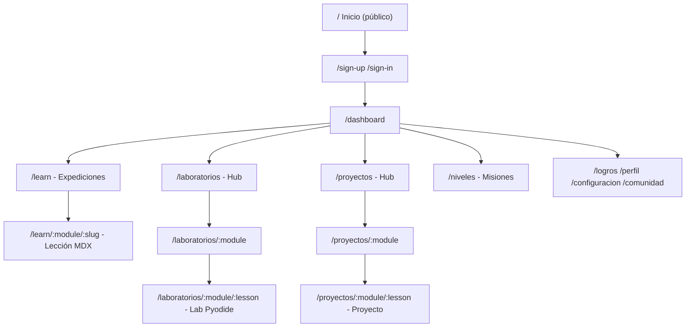
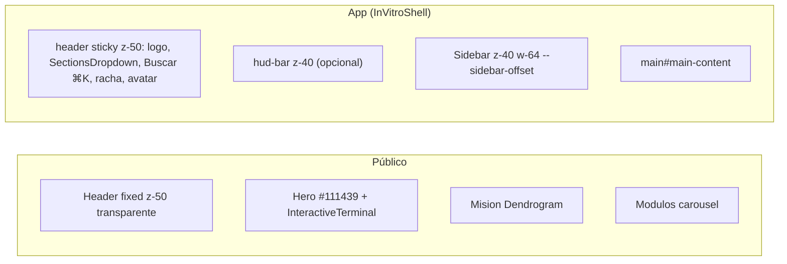
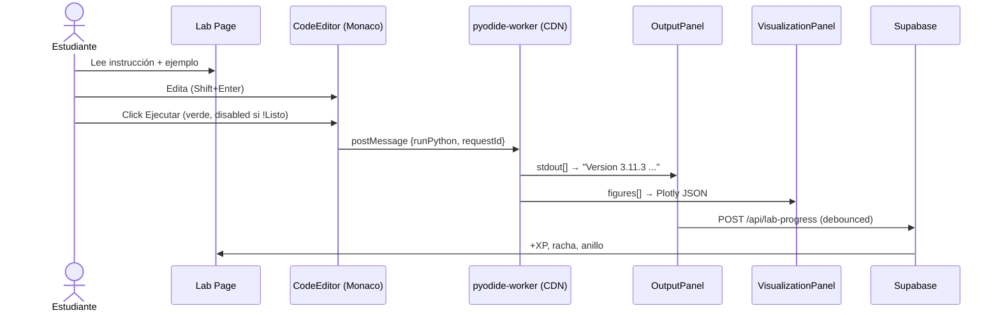

# UI/UX Schema — InVitro-Code

> Plataforma Duolingo-style para biotecnólogos que aprenden Python / Estadística / ML con labs Pyodide en el navegador.  
> Stack: Next.js 16 (App Router, Turbopack) + Tailwind v4 + Clerk + Supabase + Monaco + Plotly. Contenido MDX. Lang `es`.

---

## 1) Principios

- **1 concepto = 1 terminal.** Todo lo rompible está a 1 click de `Ejecutar` y 1 de `Restaurar`.
- **Cero instalación.** Pyodide 0.25.0 vía `cdn.jsdelivr.net`, `numpy` preload, resto lazy. `Listo` en el botón es la única señal de readiness.
- **Español + biotecnología.** Ejemplos con secuencias, qPCR, California Housing, Breast Cancer, no `foo/bar`.
- **Gamificación como feedback, no como juego.** XP, racha y anillo son consecuencia de ` POST /api/lab-progress`, no el objetivo.

---

## 2) Personas

| Persona | Contexto | Job |
|---|---|---|
| **Ana, 20, 3er sem. Biotecnia** | Nunca tocó Python, analiza qPCR en Excel | Probar código sin instalar nada y ver su primer gráfico en <60s |
| **Marcos, 22, tesista** | Sabe R, necesita ML para RNAseq | Proyecto guiado que pueda poner en portafolio y defender |
| **Profe** | Valida hallazgos | Que el estudiante documente `venv`/`requirements.txt`/métricas |

---

## 3) Arquitectura de información





---

## 4) Shells

### 4.1 RootLayout (`src/app/layout.tsx`)

```tsx
<html lang="es" class="inter space_grotesk jetbrains_mono">
  <ClerkProvider>
    <a href="#main-content">Saltar al contenido</a>
    {children}
```

Fuentes: `Inter --font-body`, `Space Grotesk --font-display`, `JetBrains Mono --font-mono`. Tokens: `bg-surface #F8FBFA`, `ink #101B3D/#111439`, `mint #0AAE9A`, `surface-card #fff`.

### 4.2 Landing Header (`src/components/landing/Header.tsx`)

`fixed z-50` → transparente sobre hero, `bg-surface-card/95 + shadow + backdrop-blur` al scrollear (`window.scrollY > 20`).

### 4.3 InVitroShell (`src/components/layout/InVitroShell.tsx`)

```
sticky top-0 z-50 border-b bg-surface/80 backdrop-blur-xl (h-14)
├─ izq: logo + SectionsDropdown (Inicio, Expediciones, Laboratorios, Proyectos, Misiones, Dashboard, Logros, Comunidad, Perfil, Configuración)
└─ der: [Buscar ⌘K] [🔥 racha] [avatar] [Logout] [hamburguesa md:hidden]

hud-bar? sticky top-14 z-40
main min-h-[calc(100vh-56px)]
```

### 4.4 Sidebar Learn (`src/components/learn/Sidebar.tsx`)

`fixed z-40 lg:static w-64`, colapsable via `--sidebar-offset` (`256px` / `0px` en `≥1024px`, `0px` en mobile). Mobile: `translate-x` + backdrop `z-30`. Escucha `pathname` para expandir módulo activo y `scrollIntoView` de la lección.

---

## 5) Páginas

### 5.1 Landing `/`

```
[Header]
[Hero #111439] "Aprende IA y ML con Python" + [Comenzar][Iniciar] + <InteractiveTerminal>
[Misión] Dendrograma raíz → Misión/Visión → 4 cards (Aprendizaje Activo, Comunidad...)
[Módulos] Expediciones carousel 4 cards (IA 100XP, Python 425XP, Estadística 250XP, ML 300XP)
[Equipo] Marcos card
[Contacto] invitro.code@gmail.com
[Footer bg-ink]
```

### 5.2 Hubs `/laboratorios` y `/proyectos`

`HeroWithConsole` (banner `/laboratorio/*` o `/proyectos/*` + `HubConsole`) + `ModuleGrid 4→2→1 cols`

`ModuleCard = { tint, art, title, desc, labCount, xpReward, completed/total → LabProgressRing 36px }`

`/laboratorios/:module` y `/proyectos/:module` comparten lista con `LabHistoryCard` (`not_started`/`in_progress`/`completed`).

### 5.3 Lección `/learn/:module/:slug`

`Sidebar | [crumb] [LabHeader] [MDX Sections carousel] [Pager]` — MDX split por `<Section>` y `Resumen` filtrado.

### 5.4 Lab `/laboratorios/:module/:lesson` (core)

```
[← Sala] Fundamentos de ML · Machine Learning +30 XP  [Laboratorio|Cuestionario] [Copiar R] [Descargar notebook] [Abrir Colab]

┌─ ConsoleFrame "Consola de Salida" ─┐  ┌─ ConsoleFrame "Consola Visualización" ─┐
│ [●●●] Salida   [Limpiar][Maximizar] │  │ [●●●] Visualización   [Maximizar]     │
│ La salida aparecerá...              │  │ La visualización aparecerá...         │
└────────────────────────────────────┘  └────────────────────────────────────┘

┌─ ConsoleFrame "main.py" [Listo] [Ejecutar] [Maximizar/Restaurar 38×38] ─┐
│ 1  # LAB 1: Fundamentos ML                                              │
│ 18 np.random.seed(42)                                                   │
│    Monaco console-dark #0a0a0a h:400 normal | 100% maximizado (flex-1)  │
└────────────────────────────────────────────────────────────────────────┘
```

Maximizado: `createPortal → body.fixed inset-0 z-[60] py-4 pr-6 paddingLeft:var(--sidebar-offset)` → `card rounded-xl border #222 bg #0a0a0a` → `titleBar z-10 + body flex-1`.

### 5.5 Proyecto `/proyectos/:module/:lesson`

```
[Volver] Título  [Descargar][Colab]
[OBJETIVOS] [DATASET] [ESCENARIO] [INSTRUCCIONES]
— 23/41 sin editor (asignación pura, ej. python Instalando Python: crear venv)
— 18/41 con editor idéntico al lab (ej. python Bucles→NumPy, ml Gradient Boosting)
```

### 5.6 Perfil / Logros

Avatar iniciales, racha, XP total, anillos por módulo, `LabHistoryCard`.

---

## 6) Flujo del lab



Estados: `Cargando Pyodide…` → `Listo` → `Ejecutando…` (spinner `#3fb950`) → `Salida` / `Gráfico 1` → validación → `Certificar` (flag off).

---

## 7) Design system

**ConsoleFrame** (`src/components/editor/ConsoleFrame.tsx`): `rounded-xl border #222 bg #0a0a0a shadow-2xl`, titleBar `bg #111 border #1d1d1d` + semáforo `#ff5f56 #ffbd2e #27c93f`, scanline `opacity 0.03`, botón `p-2 border #2a2a2a bg #1a1a1a text-white 20px`, focus `ring white/60`.

**CodeEditor** (`CodeEditor.tsx`): Monaco `console-dark` (`bg #0a0a0a`, cursor `#3fb950`), `minimap:false`, `wordWrap:on`, `automaticLayout:true`.

**Cards**: `rounded-2xl border surface-raised`, `theme.tint` como `bg`, `LabProgressRing 36px`.

**Interacción**: `disabled bg #1d1d1d text #555`, `hover:bg #2a2a2a`, `active:scale-95`.

---

## 8) Responsive & estados vacíos

- Header colapsa a `mobile-nav` `md:hidden`, Sidebar a `fixed translate-x` + botón `lg:hidden`.
- Grids `4 → 2 → 1`.
- Vacíos: `"No hay proyectos disponibles"` / `"La salida aparecerá..."` / `"La visualización aparecerá..."`.

---

## 9) Capturas de referencia

- `lesson01_ml_fundamentals` normal `~93KB` / maximizado `~180KB` (viewport 1346×667, editor `h:659-981` según ancho, títuloBar `h:47`).
- Tour automatizado: `41 labs` (todos `Listo` + `hasEditor` + `shotOk` + `maximize h>500`) y `41 proyectos` (18 con consola `Listo/h>500`, 23 asignación pura `shotOk`). Scripts: `npm run tour:quick` (12 páginas, ~60s) y `npm run tour` (82 páginas).

---

## 10) Accesibilidad

`Skip link → #main-content`, `aria-label Maximizar/Restaurar`, `focus-visible:ring`, `document.fonts.ready` antes de `screenshot`, CSP `style-src cdn.jsdelivr.net`, `z-[60]` sobre header `z-50`.

---

*Generado desde `InVitroShell`, `Sidebar`, `ConsoleFrame`/`CodeEditor`/`OutputPanel`/`VisualizationPanel`, `HeroWithConsole`/`ModuleGrid`, `LabHeader` y tours Playwright reales.*
